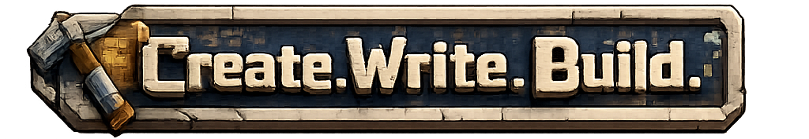

Mod for Minecraft Fabric, which adds full-fledged 3D blocks for building signs, inscriptions and other decorations.


For this mod to work, you need to have a **Fabric API**.
The project is licensed under Apache 2.0. For more information, please see the license file.

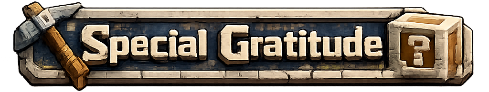

The developer **expresses special gratitude** to the player with the nickname **SparkyBoy2024** for the opportunity to 
test the mod on the server (version **1.21.4**)✨.

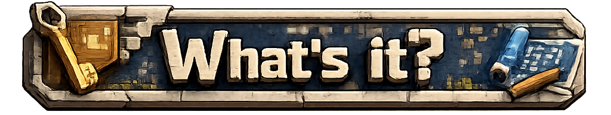

**OpenLetters** is a mod that adds full—fledged three-dimensional letters and symbols in the form of blocks to Minecraft. 
Each letter is a separate block, which is cut out of ordinary white concrete, and can be placed, repainted, combined 
with frames and assembled into whole words and sentences.

The mod is perfect for:

🏙️ Building cities with realistic signage

🛣️ Creating waypoints for directions

🎨 Decorative buildings and art objects

🗺️ Maps and servers with navigation

🌍 Multilingual projects (Latin & Cyrillic alphabets, diacritics, custom symbols)

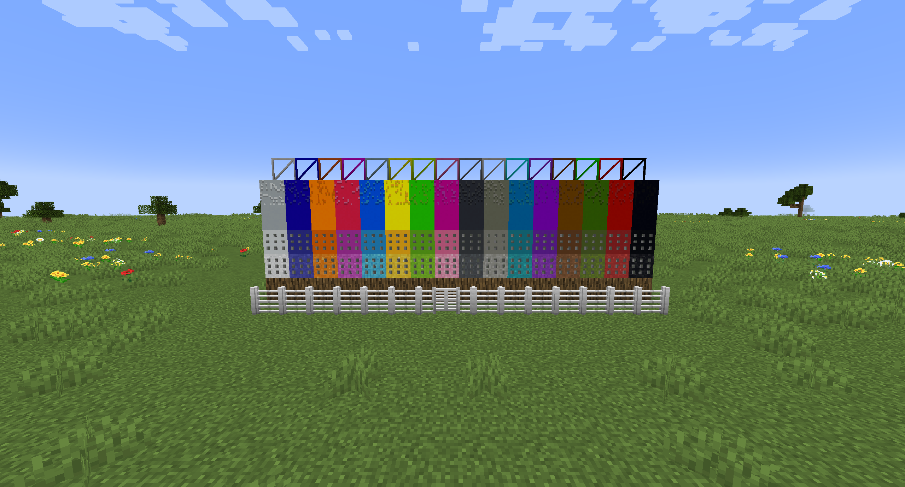

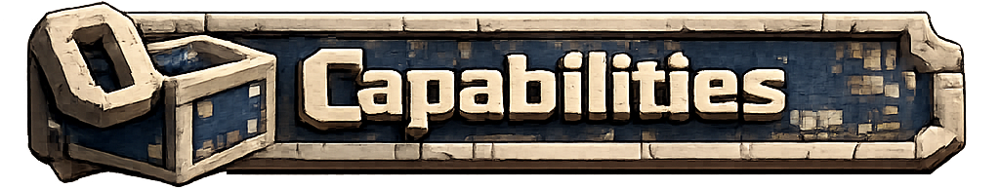

##### 🔤 Full alphabet

Latin & Cyrillic letters, numbers 0-9, symbols and some diacritics  

##### 🪨 New decorative blocks  

Colored concrete powder with bars, from which colored ferroconcrete can be crafted, by painting which rich colored 
ferroconcrete  can be obtained! But how to mine each block correctly?

| Block                       | Instrument | Without Silk touch          | With a Silky touch          |
|-----------------------------|------------|-----------------------------|-----------------------------|
| 🎨Rich Ferroconcrete        | Pickaxe    | Iron bars                   | The block itself            |
| 🧱Ferroconcrete             | Pickaxe    | Iron bars                   | The block itself            |
| ⛓️Concrete powder with bars | Shovel     | Iron bars + concrete powder | Iron bars + concrete powder |
| 🔠Letter Block              | Pickaxe    | The block itself            | The block itself            |

##### 🌈 16 colors              

Each block can be painted to all 16 Minecraft colors

##### 🧩Addon system        

Add your letters via JSON — without reassembling the mod. For a complete guide on adding your own block, see 
the Mod Developer's Guide section.

##### 🌫️Exfoliation 

Rich ferroconcrete exfoliated over time, similar to copper oxidation: `Rich Ferroconcrete → Exfoliated Ferroconcrete → Regular Ferroconcrete`.
Timely tinting by hand with a dye, clicking right mouse button on the exfoliated ferroconcrete, will return the original 
appearance to your buildings made of rich ferroconcrete✨. **The main thing** is not to wait for the paint to completely 
peel off your blocks, otherwise you will have to re-paint them in the workbench!😭

| Action                                                             | Result                         |
|--------------------------------------------------------------------|--------------------------------|
| Use 🧹**brush** on rich ferroconcrete                              | 🌫️Accelerates exfoliation     |
| Craft **dye + exfoliated ferroconcrete**                           | 🎨Restores color               |
| Exfoliated ferroconcrete has already become a normal ferroconcrete | 🚫Recovery **is not possible** |

> ⚙️ Don't like the mechanics? Disable it via GameRule:
> ``
> /gamerule exfoliationEnabled false
> ``

##### 🖼️ Frames            

Colourful frames, repainted in the workbench, can become a frame for your letters!

1. Take the coloured **Frame** in your hand.
2. Click right mouse button on the letter.
3. The letter will get a colored cover!
4. To remove the frame, use a **hoe** on the letter (sticks will fall out).

##### 🚧 Iron fence        

Unique custom models of fences and gates.

##### 🔄 Migration of worlds    

Old buildings are converted automatically. Since there is no cropped ferroconcrete, this block is automatically 
converted to rich ferroconcrete + letter. However, despite the simplicity of migration, this mechanism may not be ideal, 
so **please make backups of your worlds** if you do not want to accidentally lose your aesthetics✨.

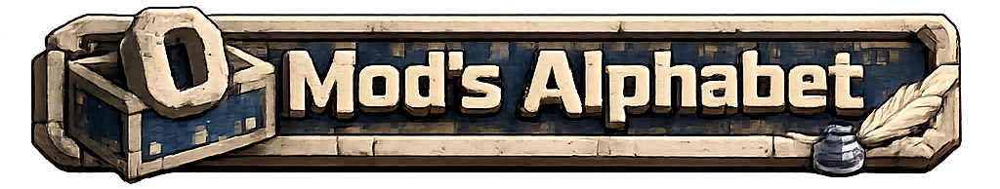
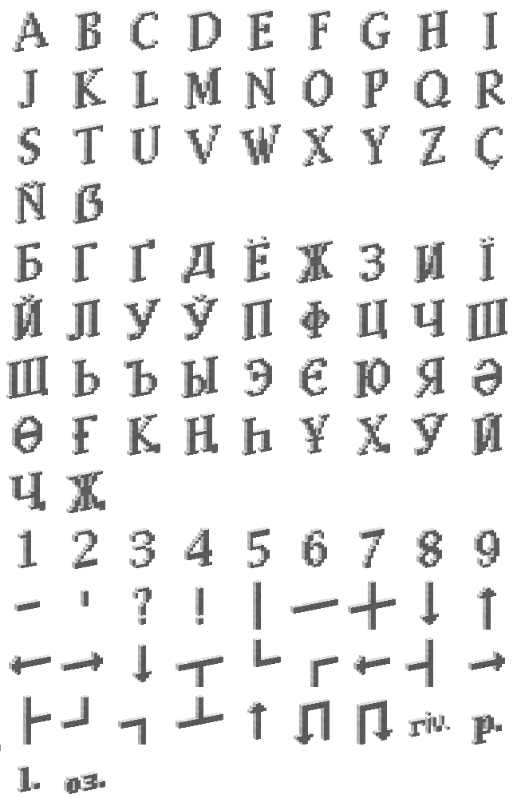

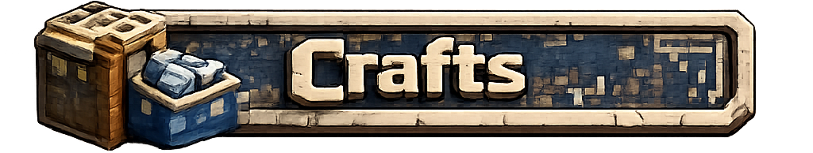
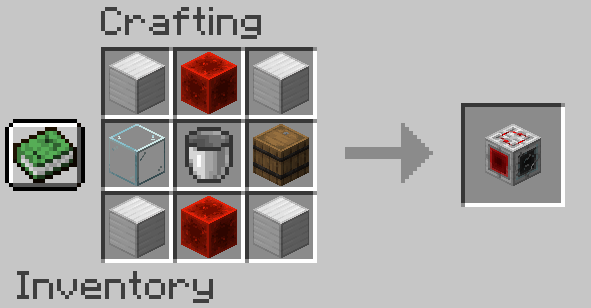
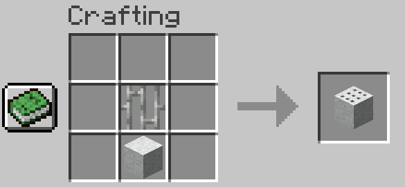
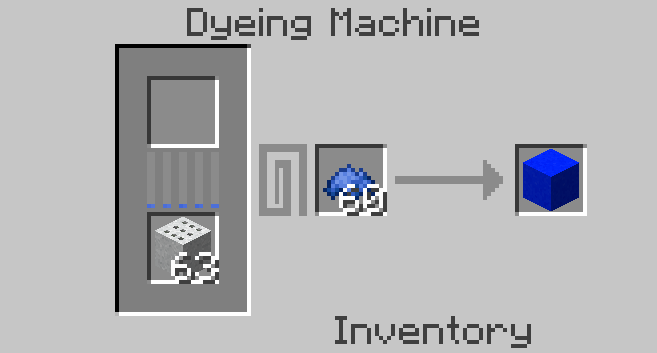
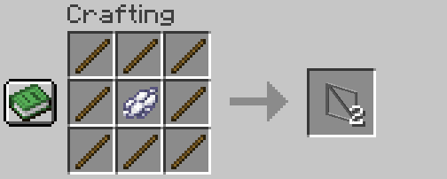
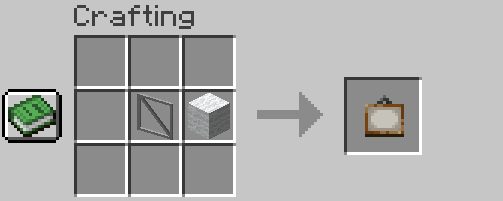
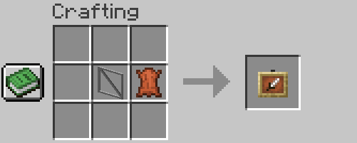
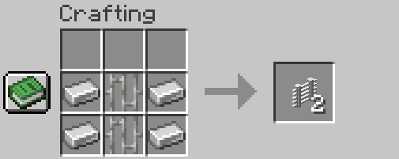
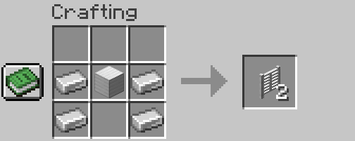
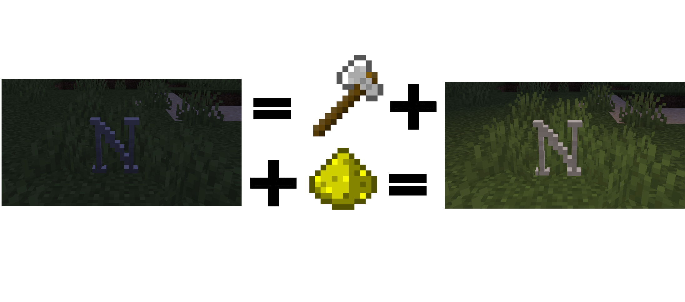
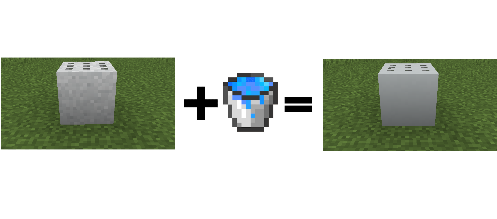

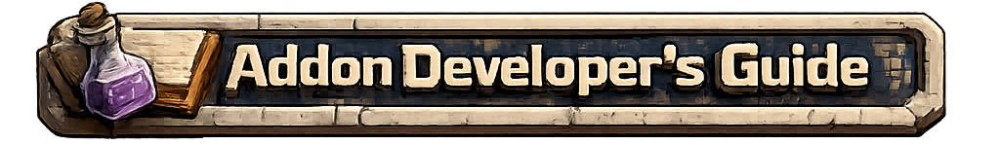

OpenLetters supports **custom letters** without having to fork or rebuild the mod!

#### Quick start

1. Create a JSON file with a 3D model of the letter (f.g. via Blockbench).
2. Add the meta fields `name` (what will your letter be called in the game), `author` (author's nickname for convenience), 
and `version` (version of your block for convenience). For example:
```json   
{
  "name": "Plus",
  "author": "Ortodontalio",
  "elements": [
    {
      "from": [7,5,14],
      "to": [9,11,16],
      "faces": {
        "north": {
          "uv": [0,0,2,6]
        },
        "east": {
          "uv": [0,0,1,6]
        },
        "south": {
          "uv": [0,0,2,6]
        },
        "west": {
          "uv": [0,0,1,6]
        },
        "up": {
          "uv": [0,0,2,1]
        },
        "down": {
          "uv": [0,0,2,1]
        }
      }
    },
    {
      "from": [5,7,14],
      "to": [11,9,16],
      "faces": {
        "north": {
          "uv": [0,0,6,2]
        },
        "east": {
          "uv": [0,0,1,2]
        },
        "south": {
          "uv": [0,0,6,2]
        },
        "west": {
          "uv": [0,0,1,2]
        },
        "up": {
          "uv": [0,0,6,1]
        },
        "down": {
          "uv": [0,0,6,1]
        }
      }
    }
  ]
}
```
3. Put the file in the folder:
```   
.minecraft/mods/openletters/
   └── letter_plus.json
```
4. Launch the game. The mod will automatically generate:
- ✅ Block and item;
- ✅ Model and blockstate;
- ✅ Recipe in stone cutter;
- ✅ Loot table;
- ✅ Tag `mineable/pickaxe`.

A separate tab will appear in the game with all addons that have been successfully loaded from the `/mods/openletters` folder:

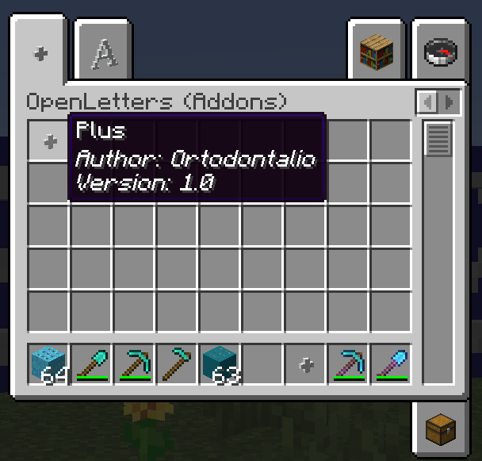

So you can also use your addons to create whatever you want!

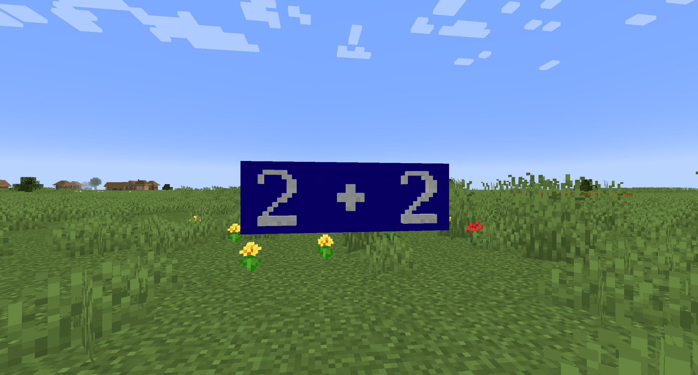

**Please note** that texturing your blocks **is not available**! Since the addon mechanism is intended exclusively for
adding new letters, all letters have the same concrete texture, which can later be repainted using dye. 
Technically this means that you can add absolutely any model, be it a letter or even a bas-relief,
the block will still have the texture of concrete.

**Please note** that if your block wasn't added to the game, it most likely has the wrong structure. 
You may have missed quotation marks, or commas, or curly braces.

**Please note** that the addon system is presented as a resource pack in the game!

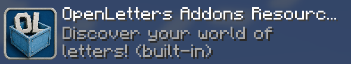