# Preface
The idea of the mod came to me when I was building a map. I like traveling, so the map was connected to the railway and 
the cities that this road connected. Over time, the map grew, and a large number of road interchanges appeared, for 
which road signs were required. The idea with banners was not ideal for me, because I thought it didn't look very 
realistic, besides, not all the letters would have turned out beautifully (due to restrictions when creating banners), 
and there was a layer between each banner. Therefore, I decided to create new blocks, each block is a letter, and I 
chose the standard blue as the background, inherent in road signs in my region. It is my first mod written using the 
Fabric library. Please do not judge strictly😁

# Features
Initially, the mod adds blocks on which letters/symbols are drawn, so that by putting these blocks next to each other, 
you can design names for buildings, signs... In principle, for everything that the soul desires! However, now each symbol is a full-fledged block with its own 3D model, in accordance with the shape of this symbol.

At the moment, the following symbols are implemented (provided that **the common letters for the alphabets are in the 
tab with the Latin alphabet**):

### Usage Ideas
In my opinion, the most important idea with which I created this small modification is the creation of road signs. 
The following screenshot shows an example of creating a road sign using the Latin alphabet:
##### Before 0.7.0

##### 0.7.0
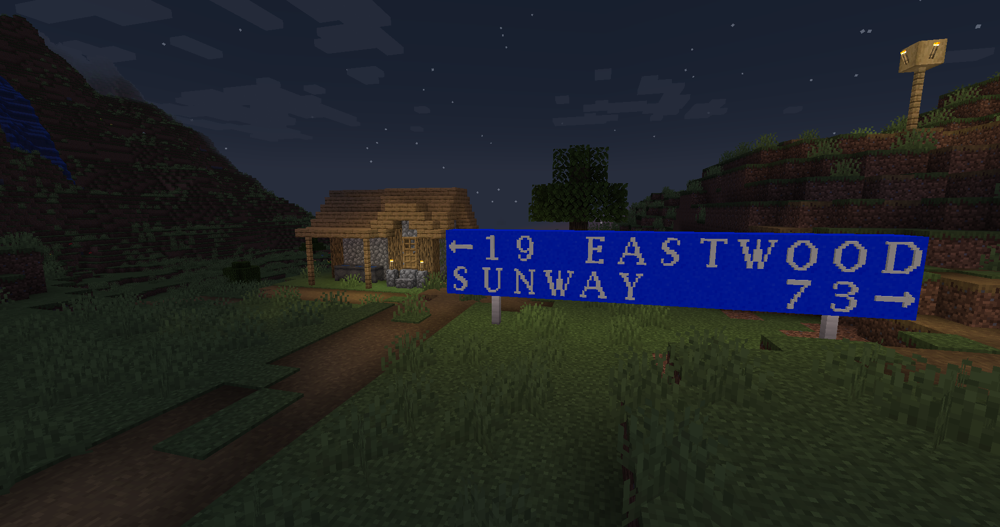
The mod also provides an opportunity to build absolutely any signpost, of any complexity:
a simple distance signpost, an arrow signpost, a signpost with a circle road and much more!

Another option for creating a road sign, but using the Russian language:
##### Before 0.7.0

##### 0.7.0
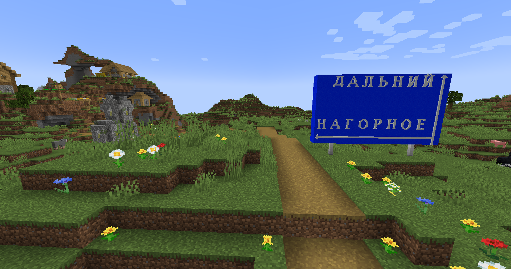
Another idea for the first point is pointers of distances to cities. The screenshot shows an example of such a sign in 
the Byelorussian language:
##### Before 0.7.0

##### 0.7.0
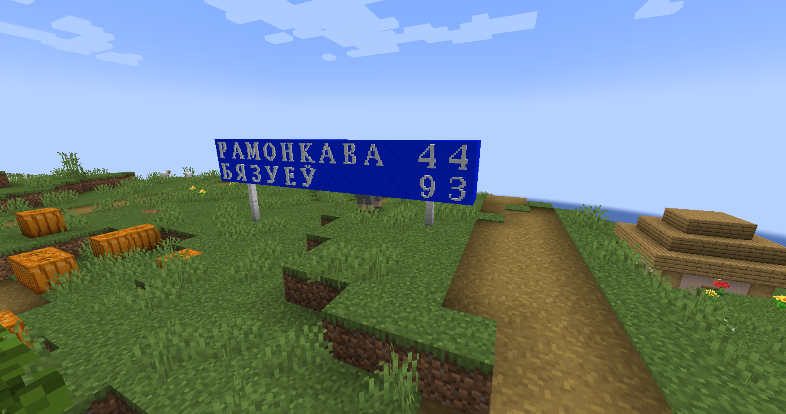
The mod also allows to design standard direction signs, indicating the distance if desired. The screenshot shows an 
example of such a sign in Ukrainian:
##### Before 0.7.0

##### 0.7.0
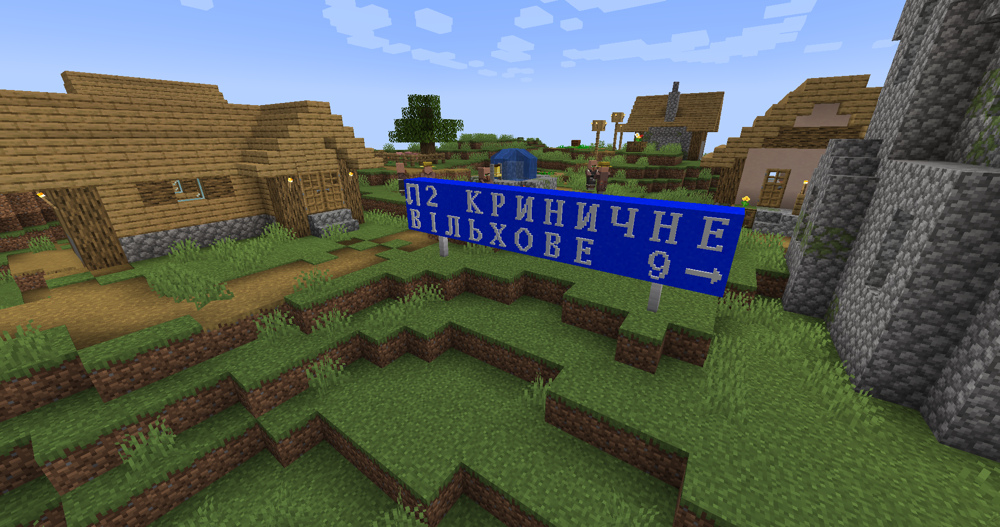
The simplest road application of letter blocks is pointers of names of settlements:
##### 0.7.0
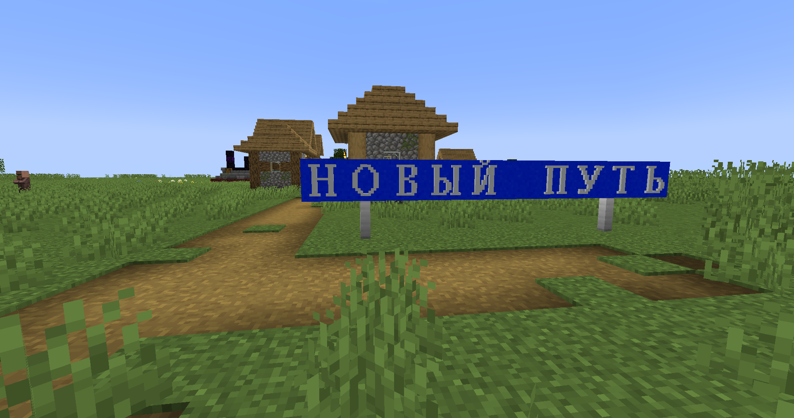
But you can make a pointer to the end of settlements using a new block - **strikethrough block**!
##### 0.7.0
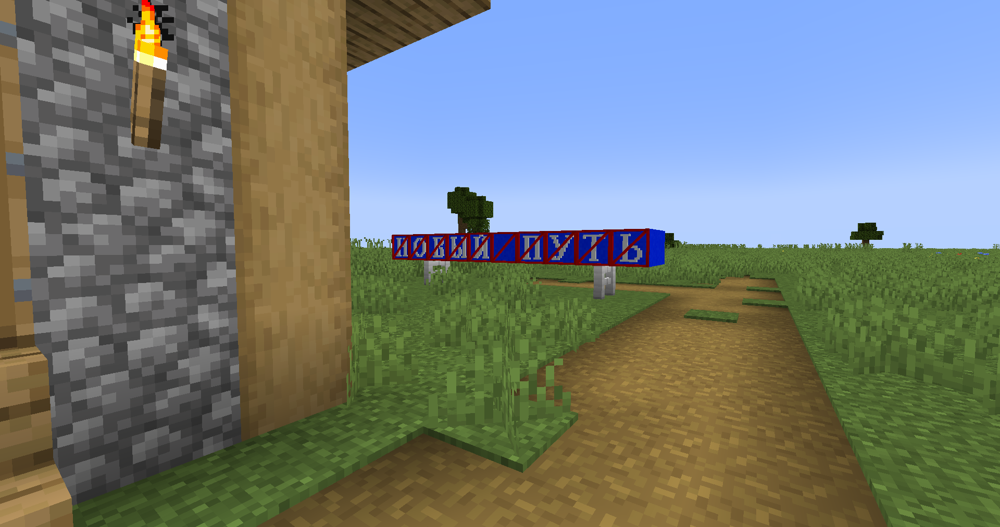
There is also the possibility of building signs with the names of rivers - a block with the abbreviation of the river in 
Russian, Belarusian, Ukrainian, as well as English is also present in this mod:
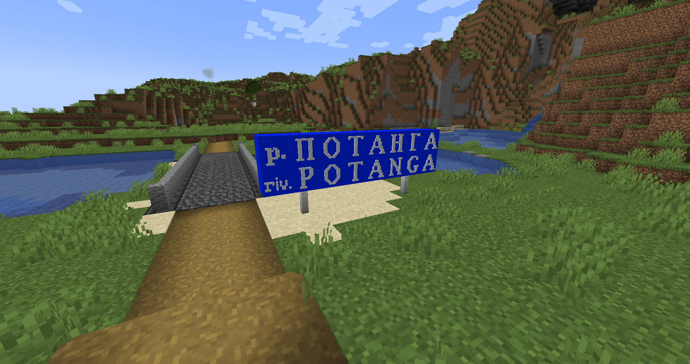
It is not necessary to use blocks only for the construction of road signs. They can be used even when you just want to 
make a sign for your store or just number a house in your city. After all, all that is required of you is to put blocks 
with letters, forming words!
##### 1.0
In addition to the usual signs, you can build absolutely any sculptures where letters are used:
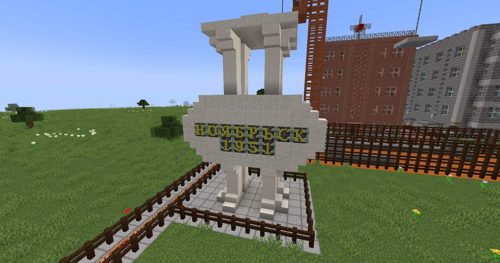
# How to use - > 1.19 (v1.0)
**It is worth saying that all the letters on the blocks since 1.0 have a separate 3D model!**

In order to get each block-symbol, it is necessary to cut the **white concrete** in a stone cutter:

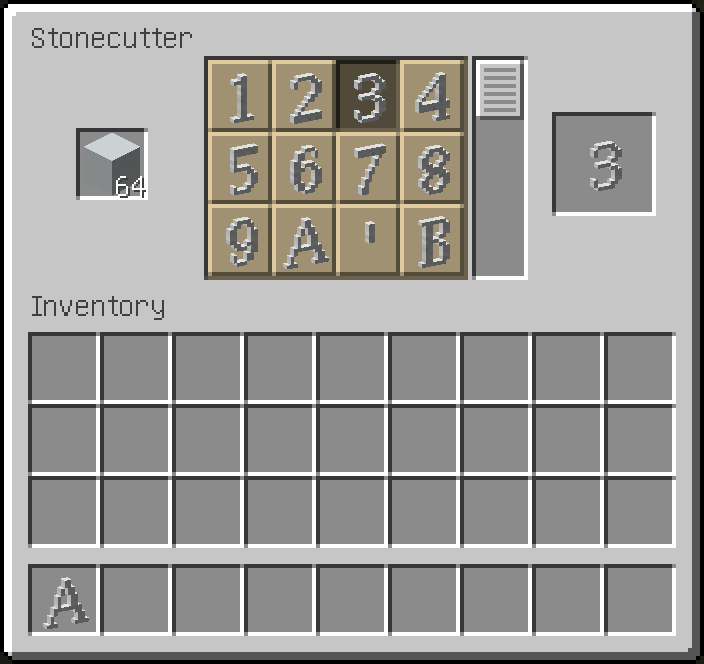

Each block-symbol can be placed either separately or on any blocks:

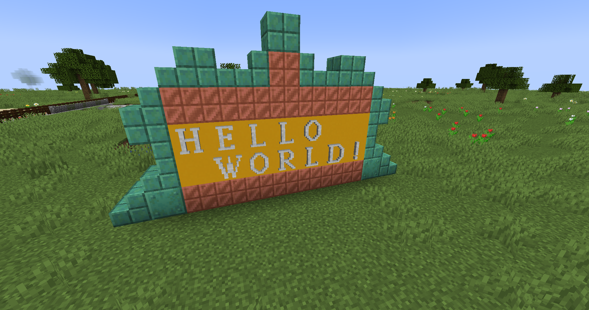

Yes, it's worth noting that letter blocks can emit light! To do this, you need to click on the block, holding a
glowstone dust in your hand. Also, you can remove the highlighting with any axe:

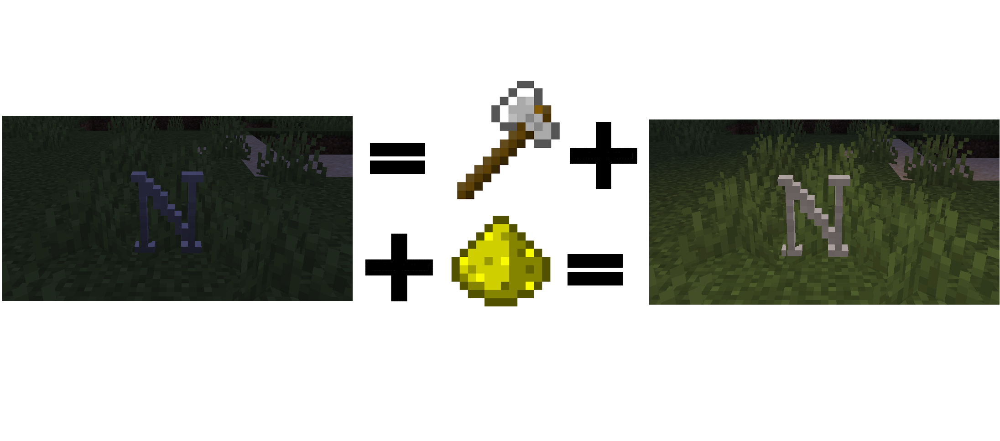

Despite the fact that the blocks-symbols are made of white concrete, they can be repainted in different colors using any dye:

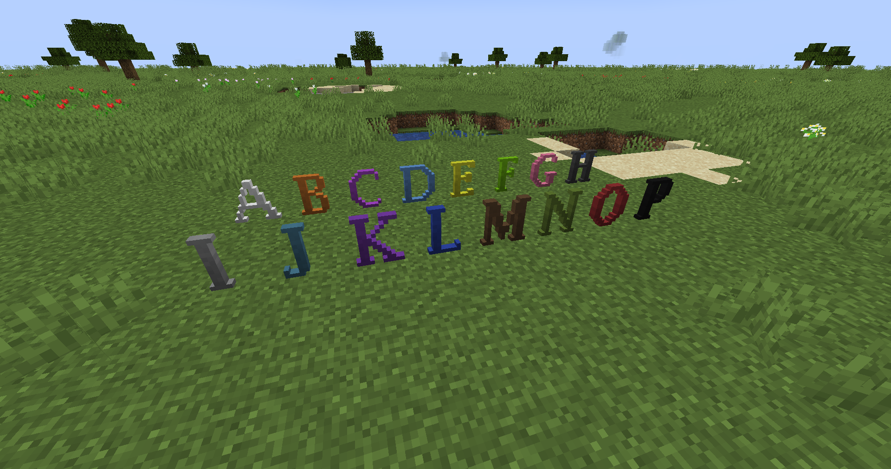

Interesting fact. If you pour water around concrete powder with bars, you can get white ferroconcrete.
But you won't be able to paint such concrete, unfortunately😔:

Also, you can combine symbols with ferroconcrete by putting any block-symbol to it, after which the cropped 
ferroconcrete turns into a sign-block:

To remove the block-symbol attached to the cropped ferroconcrete by mistake, it is necessary to use any hoe:

# How to use - > 1.18 (v.0.7.0)
**It is worth saying that all the letters on the blocks since 0.7.0 have a 3D model!**
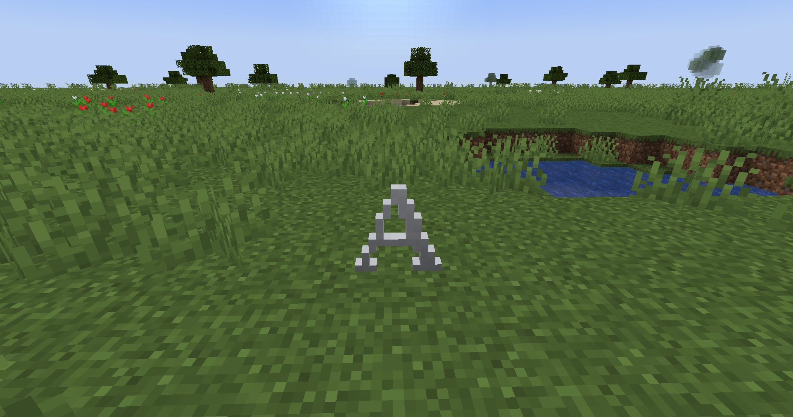

So far, to create each block, you first need to create a basic one - ferroconcrete. But to create this block, you need
to create a block of white concrete powder with bars. This is the first step on the way to creating letter blocks.

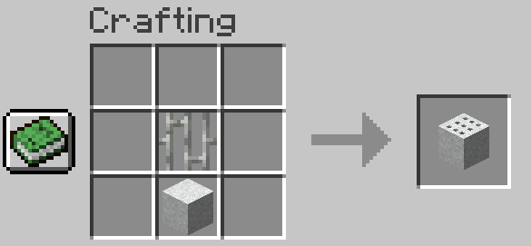

An interesting fact is that after the destruction of the block, ordinary white concrete powder falls out, and bars remain
in place of the block.

To get ferroconcrete from a block of concrete powder with bars, it is necessary to craft a dyeing machine:
##### Before 0.7.0

##### 0.7.0
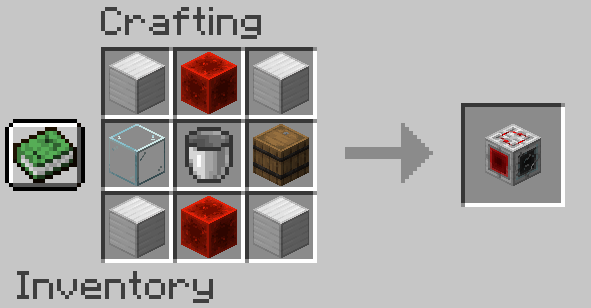

This machine accepts a bucket of water, any block of concrete powder and a dye at the entrance, 
and concrete of the color of the dye is obtained at the output. The working of this machine can also be controlled by a 
redstone: if the signal is active, the machine stops working, as well as collecting water.

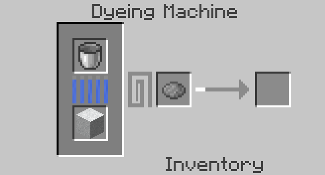

Depending on the amount of water in the internal tank, the appearance of the machine changes:

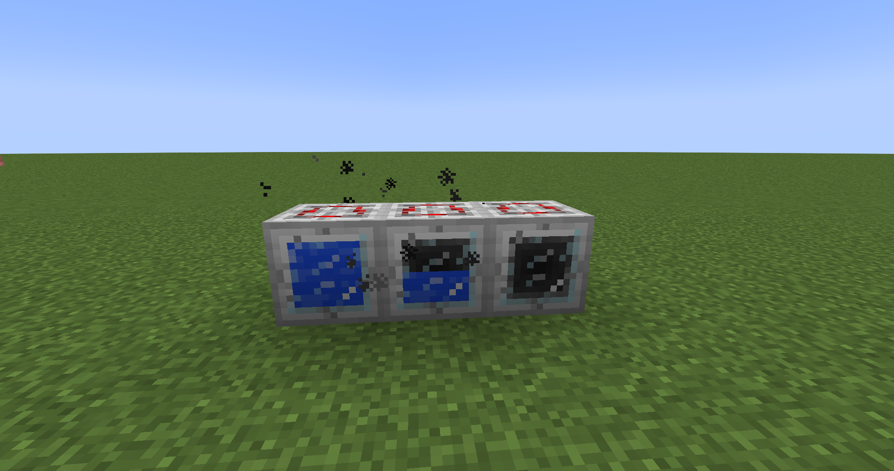

We also need to get blue ferroconcrete, so we use a dyeing machine, putting concrete powder with bars and
blue dye in it:

When a ferroconcrete block is received, it must be put into a stone cutter to get any variant of the letters blocks:

That's it! But these are not all available blocks **in 0.7.0**! In the new tab "Technical blocks", there are also: iron fence, iron gates, strikethrough block, which you can use to create more realistic road signs. For example, iron fence:

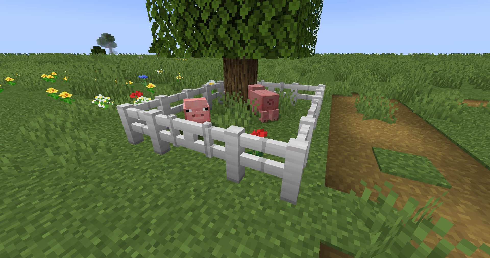

In addition to the construction of iron pens, it can be used for road sign posts. Fence crafting is next:
##### Before 1.20.4
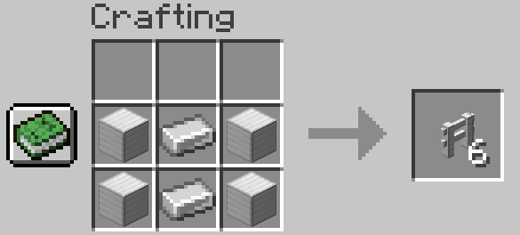
##### 1.20.4
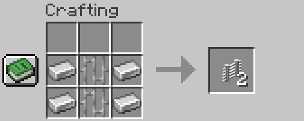

It is also possible to craft an iron gate:
##### Before 1.20.4
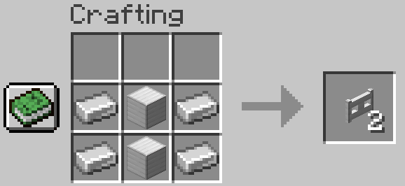
##### 1.20.4
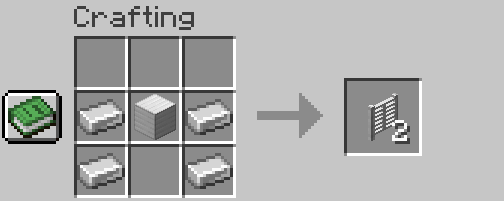

Also, to craft a strikethrough block, you must have the following items:

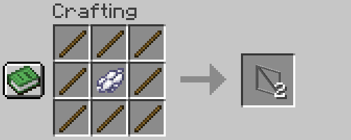

In addition to creating crossed-out letters, this block can have other uses, for example, the construction of strange structures like this:

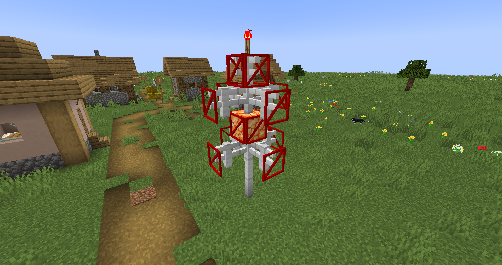
#  How to use - 1.18 (before 0.7.0)
So far, to create each block, you first need to create a basic one - ferroconcrete. Below is the crafting of this block. 
It is worth noting that the crafting and appearance of the base block are planned to be changed in the future. 

When a ferroconcrete block is received, it must be put into a stone cutter to get any variant of the letters blocks: 

That's it! In the future, it is planned to add a special block to create letter blocks for greater realism.

It is worth noting that all blocks use 16x16 standard resolution textures to avoid an obvious difference between standard blocks and blocks from the mod.

# Do you have a question or proposal?
If you have any suggestions (for example, support for new languages), ideas, and also bugs found, please email me - 
**ortodontalio@gmail.com**, I will try to answer you as soon as possible, and I will be glad to receive your emails. 
**Please do not write spam or insults, otherwise you will be blocked.**
